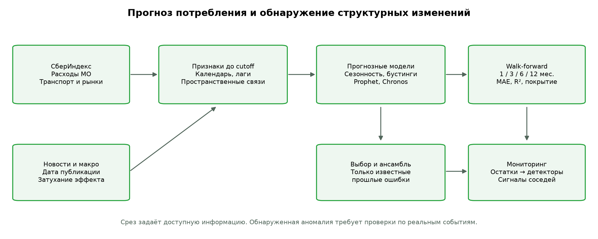
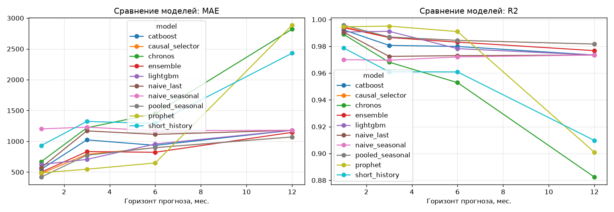
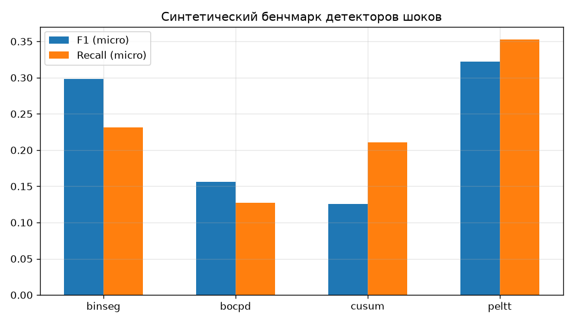
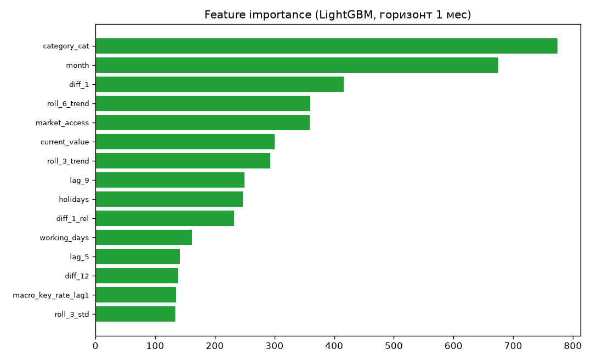

# Методологический отчёт

## Прогнозирование и обнаружение точек структурных изменений

Решение прогнозирует расходы каждого муниципалитета через 1, 3, 6 и 12 месяцев. Модели получают только известную к началу прогноза историю. После поступления факта система проверяет, насколько необычно его отклонение от прогноза, и учитывает прежние сигналы соседних территорий. Такие сигналы помогают выбрать случаи для проверки; предупреждение реальных будущих шоков пока не подтверждено независимой разметкой.

### 1. Данные

- consumption: 24 мес (2023-01..2024-12), 2190 МО, 6 категорий расходов

- market_access: индекс доступности рынков (2571 МО)

- connection: граф расстояний highway/railway (5.9 млн рёбер)

### 2. Прогнозирование (walk-forward, MAE обязателен)

Сравнение на **одинаковых наблюдениях** всех моделей внутри каждого горизонта. Метрики всех доступных серий отдельно: `outputs\full_audited\forecast_summary.csv`.

Прогон: 2190 МО; проверочный режим: False. Проверочный режим ограничивает бустинг 100 итерациями.

Prophet — до 40 серий. Таблица MAE/R2 по точным горизонтам:

| model | horizon | n_pairs | mae | rmse | mape | r2 |
|---|---|---|---|---|---|---|
| pooled_seasonal | 1 | 423 | 420.14 | 873.47 | 8.07 | 0.9958 |
| causal_selector | 1 | 423 | 478.01 | 998.66 | 7.96 | 0.9945 |
| prophet | 1 | 423 | 488.45 | 986.46 | 14.61 | 0.9946 |
| ensemble | 1 | 423 | 499.20 | 1043.53 | 7.97 | 0.9940 |
| catboost | 1 | 423 | 546.55 | 1179.41 | 7.64 | 0.9923 |
| naive_last | 1 | 423 | 573.56 | 1300.64 | 8.34 | 0.9906 |
| lightgbm | 1 | 423 | 623.20 | 1299.34 | 8.42 | 0.9907 |
| chronos | 1 | 423 | 669.67 | 1412.03 | 8.86 | 0.9890 |
| short_history | 1 | 423 | 932.04 | 1957.71 | 11.57 | 0.9788 |
| naive_seasonal | 1 | 423 | 1201.48 | 2327.33 | 15.93 | 0.9700 |
| prophet | 3 | 154 | 547.49 | 970.68 | 15.48 | 0.9951 |
| lightgbm | 3 | 154 | 706.54 | 1297.82 | 12.05 | 0.9912 |
| pooled_seasonal | 3 | 154 | 773.60 | 1579.29 | 11.91 | 0.9870 |
| causal_selector | 3 | 154 | 788.62 | 1582.98 | 12.00 | 0.9869 |
| ensemble | 3 | 154 | 833.60 | 1604.14 | 11.45 | 0.9866 |
| catboost | 3 | 154 | 1023.44 | 1923.07 | 13.43 | 0.9807 |
| naive_last | 3 | 154 | 1169.38 | 2295.76 | 14.26 | 0.9725 |
| chronos | 3 | 154 | 1219.72 | 2469.44 | 14.65 | 0.9682 |
| naive_seasonal | 3 | 154 | 1230.25 | 2412.01 | 15.44 | 0.9696 |
| short_history | 3 | 154 | 1322.66 | 2734.98 | 15.16 | 0.9610 |
| prophet | 6 | 155 | 648.74 | 1315.96 | 22.00 | 0.9910 |
| ensemble | 6 | 155 | 822.25 | 1804.52 | 12.85 | 0.9831 |
| causal_selector | 6 | 155 | 897.25 | 1732.99 | 12.95 | 0.9844 |
| pooled_seasonal | 6 | 155 | 897.25 | 1732.99 | 12.95 | 0.9844 |
| catboost | 6 | 155 | 934.63 | 1970.24 | 12.58 | 0.9799 |
| lightgbm | 6 | 155 | 956.46 | 2048.74 | 14.53 | 0.9783 |
| naive_last | 6 | 155 | 1112.44 | 2281.35 | 15.50 | 0.9730 |
| naive_seasonal | 6 | 155 | 1171.90 | 2321.01 | 14.72 | 0.9721 |
| short_history | 6 | 155 | 1290.41 | 2747.91 | 14.93 | 0.9609 |
| chronos | 6 | 155 | 1449.88 | 3015.58 | 18.74 | 0.9529 |
| pooled_seasonal | 12 | 39 | 1070.94 | 2117.11 | 13.10 | 0.9817 |
| causal_selector | 12 | 39 | 1070.94 | 2117.11 | 13.10 | 0.9817 |
| ensemble | 12 | 39 | 1145.41 | 2383.98 | 30.08 | 0.9768 |
| catboost | 12 | 39 | 1179.67 | 2546.37 | 12.91 | 0.9735 |
| lightgbm | 12 | 39 | 1179.67 | 2546.37 | 12.91 | 0.9735 |
| naive_last | 12 | 39 | 1179.67 | 2546.37 | 12.91 | 0.9735 |
| naive_seasonal | 12 | 39 | 1179.67 | 2546.37 | 12.91 | 0.9735 |
| short_history | 12 | 39 | 2430.27 | 4699.41 | 21.40 | 0.9097 |
| chronos | 12 | 39 | 2820.32 | 5363.68 | 25.86 | 0.8824 |
| prophet | 12 | 39 | 2884.65 | 4922.82 | 112.64 | 0.9010 |

### 3. Обнаружение структурных изменений (синтетический бенчмарк)

Micro-метрики суммируют TP/FP/FN по всему корпусу. Офлайн-точка изменения — локализация, а не время доступности предупреждения.

| detector | precision | recall | f1 | задержка онлайн-сигнала |
|---|---|---|---|---|
| binseg | 0.421 | 0.231 | 0.299 | nan |
| bocpd | 0.203 | 0.127 | 0.156 | 1.18 |
| cusum | 0.090 | 0.211 | 0.126 | 1.59 |
| peltt | 0.296 | 0.353 | 0.322 | nan |

По micro-F1 на этом корпусе лучший метод — **peltt** (0.322); это оценка данного синтетического корпуса.

Для онлайн-мониторинга выбран **bocpd** (micro-F1 0.156). Переносимость на реальные шоки пока не подтверждена.

### 3.1 Реальные примеры прогноза (pooled_seasonal, h=1)

Три наблюдения общей выборки: минимальная, медианная и максимальная абсолютная ошибка. Это ошибки прогноза, а не автоматически размеченные шоки.

| МО | категория | cutoff | месяц | факт, руб. | прогноз, руб. | ошибка, руб. |
|---|---|---|---|---|---|---|
| 2547 | Общественное питание | 2024-10 | 2024-11 | 2434.00 | 2434.95 | 0.95 |
| 489 | Здоровье | 2024-03 | 2024-04 | 854.00 | 724.63 | 129.37 |
| 243 | Все категории | 2024-04 | 2024-05 | 23530.00 | 29559.79 | 6029.79 |

### 3.1 Пространственная диффузия шоков

- **8** МО-месяцев получили предупреждение о шоке от соседей (из 105493 наблюдений). Используются сигналы прошлых месяцев; способность предсказывать будущий шок требует отдельной проверки.

### Новости

Новостной конвейер проверен на демонстрационном корпусе; Granger-выводы и прирост качества на этих синтетических новостях не оцениваются.

### 3.2 Важность признаков

Топ-5 признаков (LightGBM, горизонт 1):

- `category_cat` (importance 774)
- `month` (importance 675)
- `diff_1` (importance 416)
- `roll_6_trend` (importance 360)
- `market_access` (importance 359)

### Полная панель: модели на одинаковых наблюдениях

| model | horizon | n_pairs | mae | rmse | mape | r2 |
| --- | --- | --- | --- | --- | --- | --- |
| pooled_seasonal | 1 | 137856 | 421.639 | 791.834 | 7.652 | 0.995 |
| causal_selector | 1 | 137856 | 427.148 | 795.599 | 7.865 | 0.995 |
| ensemble | 1 | 137856 | 512.269 | 1018.209 | 7.284 | 0.993 |
| catboost | 1 | 137856 | 534.767 | 1090.296 | 7.344 | 0.991 |
| naive_last | 1 | 137856 | 559.785 | 1197.115 | 8.034 | 0.990 |
| lightgbm | 1 | 137856 | 584.421 | 1154.632 | 7.880 | 0.990 |
| chronos | 1 | 137856 | 660.512 | 1317.586 | 8.708 | 0.987 |
| short_history | 1 | 137856 | 999.074 | 1840.961 | 13.178 | 0.976 |
| naive_seasonal | 1 | 137856 | 1317.600 | 2207.905 | 18.183 | 0.965 |
| lightgbm | 3 | 50154 | 778.307 | 1430.847 | 11.568 | 0.986 |
| pooled_seasonal | 3 | 50154 | 781.180 | 1417.944 | 12.441 | 0.986 |
| causal_selector | 3 | 50154 | 781.226 | 1417.957 | 12.441 | 0.986 |
| ensemble | 3 | 50154 | 941.029 | 1724.755 | 11.812 | 0.980 |
| catboost | 3 | 50154 | 982.434 | 1839.487 | 12.143 | 0.977 |
| naive_last | 3 | 50154 | 1182.350 | 2263.564 | 13.838 | 0.965 |
| chronos | 3 | 50154 | 1288.951 | 2421.379 | 15.147 | 0.960 |
| naive_seasonal | 3 | 50154 | 1357.831 | 2271.944 | 17.949 | 0.965 |
| short_history | 3 | 50154 | 1441.734 | 2627.014 | 16.953 | 0.953 |
| causal_selector | 6 | 50094 | 881.377 | 1555.034 | 13.931 | 0.984 |
| pooled_seasonal | 6 | 50094 | 881.377 | 1555.034 | 13.931 | 0.984 |
| ensemble | 6 | 50094 | 969.060 | 1897.499 | 12.564 | 0.976 |
| catboost | 6 | 50094 | 1015.016 | 2010.189 | 12.891 | 0.973 |
| lightgbm | 6 | 50094 | 1016.968 | 1964.829 | 14.216 | 0.974 |
| naive_last | 6 | 50094 | 1199.921 | 2312.836 | 15.639 | 0.964 |
| naive_seasonal | 6 | 50094 | 1323.776 | 2218.317 | 17.265 | 0.967 |
| short_history | 6 | 50094 | 1437.746 | 2660.489 | 16.978 | 0.953 |
| chronos | 6 | 50094 | 1651.512 | 3039.675 | 19.479 | 0.939 |
| causal_selector | 12 | 12456 | 1350.579 | 2254.247 | 15.236 | 0.974 |
| pooled_seasonal | 12 | 12456 | 1350.579 | 2254.247 | 15.236 | 0.974 |
| catboost | 12 | 12456 | 1394.796 | 2411.678 | 15.789 | 0.970 |
| lightgbm | 12 | 12456 | 1394.796 | 2411.678 | 15.789 | 0.970 |
| naive_last | 12 | 12456 | 1394.796 | 2411.678 | 15.789 | 0.970 |
| naive_seasonal | 12 | 12456 | 1394.796 | 2411.678 | 15.789 | 0.970 |
| ensemble | 12 | 12456 | 2172.917 | 3611.014 | 20.575 | 0.933 |
| short_history | 12 | 12456 | 2759.011 | 4604.209 | 24.009 | 0.890 |
| chronos | 12 | 12456 | 3254.767 | 5330.151 | 28.736 | 0.853 |

### Попарное сравнение с Prophet на совпадающих наблюдениях

| model | baseline | horizon | n_pairs | baseline_pair_coverage | mae | baseline_mae_same_pairs | mae_skill_pct | pair_win_fraction |
| --- | --- | --- | --- | --- | --- | --- | --- | --- |
| catboost | prophet | 1 | 423 | 1.000 | 546.550 | 488.455 | -11.894 | 0.470 |
| causal_selector | prophet | 1 | 423 | 1.000 | 478.006 | 488.455 | 2.139 | 0.359 |
| chronos | prophet | 1 | 423 | 1.000 | 669.670 | 488.455 | -37.100 | 0.392 |
| ensemble | prophet | 1 | 423 | 1.000 | 499.203 | 488.455 | -2.200 | 0.494 |
| lightgbm | prophet | 1 | 423 | 1.000 | 623.197 | 488.455 | -27.585 | 0.461 |
| naive_last | prophet | 1 | 423 | 1.000 | 573.556 | 488.455 | -17.422 | 0.442 |
| naive_seasonal | prophet | 1 | 423 | 1.000 | 1201.480 | 488.455 | -145.976 | 0.194 |
| pooled_seasonal | prophet | 1 | 423 | 1.000 | 420.140 | 488.455 | 13.986 | 0.506 |
| short_history | prophet | 1 | 423 | 1.000 | 932.042 | 488.455 | -90.814 | 0.326 |
| catboost | prophet | 3 | 154 | 1.000 | 1023.445 | 547.489 | -86.934 | 0.305 |
| causal_selector | prophet | 3 | 154 | 1.000 | 788.618 | 547.489 | -44.043 | 0.364 |
| chronos | prophet | 3 | 154 | 1.000 | 1219.723 | 547.489 | -122.785 | 0.312 |
| ensemble | prophet | 3 | 154 | 1.000 | 833.605 | 547.489 | -52.260 | 0.305 |
| lightgbm | prophet | 3 | 154 | 1.000 | 706.538 | 547.489 | -29.050 | 0.364 |
| naive_last | prophet | 3 | 154 | 1.000 | 1169.377 | 547.489 | -113.589 | 0.305 |
| naive_seasonal | prophet | 3 | 154 | 1.000 | 1230.247 | 547.489 | -124.707 | 0.266 |
| pooled_seasonal | prophet | 3 | 154 | 1.000 | 773.597 | 547.489 | -41.299 | 0.396 |
| short_history | prophet | 3 | 154 | 1.000 | 1322.663 | 547.489 | -141.587 | 0.286 |
| catboost | prophet | 6 | 155 | 1.000 | 934.628 | 648.740 | -44.068 | 0.413 |
| causal_selector | prophet | 6 | 155 | 1.000 | 897.252 | 648.740 | -38.307 | 0.419 |
| chronos | prophet | 6 | 155 | 1.000 | 1449.875 | 648.740 | -123.491 | 0.258 |
| ensemble | prophet | 6 | 155 | 1.000 | 822.247 | 648.740 | -26.745 | 0.413 |
| lightgbm | prophet | 6 | 155 | 1.000 | 956.460 | 648.740 | -47.434 | 0.400 |
| naive_last | prophet | 6 | 155 | 1.000 | 1112.439 | 648.740 | -71.477 | 0.329 |
| naive_seasonal | prophet | 6 | 155 | 1.000 | 1171.897 | 648.740 | -80.642 | 0.265 |
| pooled_seasonal | prophet | 6 | 155 | 1.000 | 897.252 | 648.740 | -38.307 | 0.419 |
| short_history | prophet | 6 | 155 | 1.000 | 1290.415 | 648.740 | -98.911 | 0.277 |
| catboost | prophet | 12 | 39 | 1.000 | 1179.667 | 2884.647 | 59.105 | 0.692 |
| causal_selector | prophet | 12 | 39 | 1.000 | 1070.936 | 2884.647 | 62.875 | 0.667 |
| chronos | prophet | 12 | 39 | 1.000 | 2820.316 | 2884.647 | 2.230 | 0.487 |
| ensemble | prophet | 12 | 39 | 1.000 | 1145.412 | 2884.647 | 60.293 | 0.718 |
| lightgbm | prophet | 12 | 39 | 1.000 | 1179.667 | 2884.647 | 59.105 | 0.692 |
| naive_last | prophet | 12 | 39 | 1.000 | 1179.667 | 2884.647 | 59.105 | 0.692 |
| naive_seasonal | prophet | 12 | 39 | 1.000 | 1179.667 | 2884.647 | 59.105 | 0.692 |
| pooled_seasonal | prophet | 12 | 39 | 1.000 | 1070.936 | 2884.647 | 62.875 | 0.667 |
| short_history | prophet | 12 | 39 | 1.000 | 2430.267 | 2884.647 | 15.752 | 0.615 |

### Покрытие, ошибки по сериям и резервные прогнозы

| model | horizon | n_pairs | coverage_fraction | n_series | n_origins | macro_series_mae | median_series_mae | fallback_fraction |
| --- | --- | --- | --- | --- | --- | --- | --- | --- |
| catboost | 1 | 137970 | 1.000 | 12762 | 11 | 546.051 | 237.181 | 0.000 |
| causal_selector | 1 | 137895 | 0.999 | 12750 | 11 | 433.537 | 308.539 | 0.000 |
| chronos | 1 | 137856 | 0.999 | 12738 | 11 | 666.726 | 341.837 | 0.000 |
| ensemble | 1 | 137970 | 1.000 | 12762 | 11 | 522.464 | 288.704 | 0.000 |
| lightgbm | 1 | 137970 | 1.000 | 12762 | 11 | 597.304 | 243.270 | 0.000 |
| naive_last | 1 | 137970 | 1.000 | 12762 | 11 | 572.314 | 295.818 | 0.000 |
| naive_seasonal | 1 | 137970 | 1.000 | 12762 | 11 | 1323.967 | 655.818 | 0.000 |
| pooled_seasonal | 1 | 137856 | 0.999 | 12738 | 11 | 427.346 | 317.434 | 0.000 |
| prophet | 1 | 423 | 0.003 | 39 | 11 | 500.983 | 248.340 | 0.000 |
| short_history | 1 | 137856 | 0.999 | 12738 | 11 | 1001.649 | 532.366 | 0.000 |
| catboost | 3 | 50274 | 1.000 | 12756 | 4 | 993.792 | 407.521 | 0.000 |
| causal_selector | 3 | 50154 | 0.998 | 12714 | 4 | 786.170 | 518.359 | 0.000 |
| chronos | 3 | 50154 | 0.998 | 12714 | 4 | 1293.818 | 697.977 | 0.000 |
| ensemble | 3 | 50274 | 1.000 | 12756 | 4 | 951.955 | 488.731 | 0.000 |
| lightgbm | 3 | 50274 | 1.000 | 12756 | 4 | 794.535 | 395.618 | 0.000 |
| naive_last | 3 | 50274 | 1.000 | 12756 | 4 | 1195.454 | 542.375 | 0.000 |
| naive_seasonal | 3 | 50274 | 1.000 | 12756 | 4 | 1366.116 | 646.125 | 0.000 |
| pooled_seasonal | 3 | 50154 | 0.998 | 12714 | 4 | 786.125 | 518.359 | 0.000 |
| prophet | 3 | 154 | 0.003 | 39 | 4 | 562.119 | 348.712 | 0.000 |
| short_history | 3 | 50154 | 0.998 | 12714 | 4 | 1443.619 | 735.614 | 0.000 |
| catboost | 6 | 50304 | 1.000 | 12726 | 4 | 1028.830 | 393.054 | 0.000 |
| causal_selector | 6 | 50094 | 0.996 | 12636 | 4 | 883.716 | 538.054 | 0.000 |
| chronos | 6 | 50094 | 0.996 | 12636 | 4 | 1653.642 | 833.499 | 0.000 |
| ensemble | 6 | 50304 | 1.000 | 12726 | 4 | 980.597 | 530.270 | 0.000 |
| lightgbm | 6 | 50304 | 1.000 | 12726 | 4 | 1031.344 | 580.314 | 0.000 |
| naive_last | 6 | 50304 | 1.000 | 12726 | 4 | 1210.040 | 662.000 | 0.000 |
| naive_seasonal | 6 | 50304 | 1.000 | 12726 | 4 | 1330.912 | 592.500 | 0.000 |
| pooled_seasonal | 6 | 50094 | 0.996 | 12636 | 4 | 883.716 | 538.054 | 0.000 |
| prophet | 6 | 155 | 0.003 | 39 | 4 | 649.967 | 308.902 | 0.000 |
| short_history | 6 | 50094 | 0.996 | 12636 | 4 | 1440.316 | 709.362 | 0.000 |
| catboost | 12 | 12618 | 1.000 | 12618 | 1 | 1412.458 | 492.000 | 1.000 |
| causal_selector | 12 | 12456 | 0.987 | 12456 | 1 | 1350.579 | 479.117 | 0.000 |
| chronos | 12 | 12456 | 0.987 | 12456 | 1 | 3254.767 | 1314.745 | 0.000 |
| ensemble | 12 | 12618 | 1.000 | 12618 | 1 | 2180.589 | 825.909 | 0.000 |
| lightgbm | 12 | 12618 | 1.000 | 12618 | 1 | 1412.458 | 492.000 | 1.000 |
| naive_last | 12 | 12618 | 1.000 | 12618 | 1 | 1412.458 | 492.000 | 0.000 |
| naive_seasonal | 12 | 12618 | 1.000 | 12618 | 1 | 1412.458 | 492.000 | 0.000 |
| pooled_seasonal | 12 | 12456 | 0.987 | 12456 | 1 | 1350.579 | 479.117 | 0.000 |
| prophet | 12 | 39 | 0.003 | 39 | 1 | 2884.647 | 445.000 | 0.000 |
| short_history | 12 | 12456 | 0.987 | 12456 | 1 | 2759.011 | 1122.096 | 0.000 |

### Парное сравнение с Prophet: кластерный bootstrap, 95% интервал

| model | horizon | n_series | n_pairs | mae_difference_vs_prophet | ci_low | ci_high |
| --- | --- | --- | --- | --- | --- | --- |
| catboost | 1 | 39 | 423 | 58.096 | -56.861 | 170.218 |
| causal_selector | 1 | 39 | 423 | -10.449 | -104.674 | 64.305 |
| chronos | 1 | 39 | 423 | 181.215 | 47.001 | 340.906 |
| ensemble | 1 | 39 | 423 | 10.748 | -67.050 | 89.645 |
| lightgbm | 1 | 39 | 423 | 134.743 | 7.521 | 292.430 |
| naive_last | 1 | 39 | 423 | 85.101 | -25.204 | 215.213 |
| naive_seasonal | 1 | 39 | 423 | 713.025 | 335.200 | 1246.642 |
| pooled_seasonal | 1 | 39 | 423 | -68.315 | -178.062 | 35.202 |
| short_history | 1 | 39 | 423 | 443.588 | 172.122 | 763.404 |
| catboost | 3 | 39 | 154 | 475.955 | 233.498 | 735.535 |
| causal_selector | 3 | 39 | 154 | 241.128 | 69.494 | 440.554 |
| chronos | 3 | 39 | 154 | 672.233 | 344.531 | 1060.156 |
| ensemble | 3 | 39 | 154 | 286.115 | 118.511 | 476.912 |
| lightgbm | 3 | 39 | 154 | 159.048 | 45.352 | 275.949 |
| naive_last | 3 | 39 | 154 | 621.887 | 327.991 | 910.554 |
| naive_seasonal | 3 | 39 | 154 | 682.757 | 305.505 | 1202.709 |
| pooled_seasonal | 3 | 39 | 154 | 226.107 | 40.913 | 427.746 |
| short_history | 3 | 39 | 154 | 775.174 | 364.541 | 1332.248 |
| catboost | 6 | 39 | 155 | 285.888 | 14.098 | 538.660 |
| causal_selector | 6 | 39 | 155 | 248.512 | -41.828 | 527.990 |
| chronos | 6 | 39 | 155 | 801.136 | 295.951 | 1408.923 |
| ensemble | 6 | 39 | 155 | 173.508 | -54.491 | 439.213 |
| lightgbm | 6 | 39 | 155 | 307.721 | 35.367 | 569.380 |
| naive_last | 6 | 39 | 155 | 463.699 | 124.605 | 822.951 |
| naive_seasonal | 6 | 39 | 155 | 523.157 | 128.945 | 1004.898 |
| pooled_seasonal | 6 | 39 | 155 | 248.512 | -31.785 | 527.812 |
| short_history | 6 | 39 | 155 | 641.675 | 212.694 | 1179.941 |
| catboost | 12 | 39 | 39 | -1704.980 | -2922.182 | -670.265 |
| causal_selector | 12 | 39 | 39 | -1813.710 | -3033.958 | -830.232 |
| chronos | 12 | 39 | 39 | -64.330 | -1318.527 | 1224.857 |
| ensemble | 12 | 39 | 39 | -1739.234 | -2824.564 | -786.789 |
| lightgbm | 12 | 39 | 39 | -1704.980 | -2936.353 | -673.697 |
| naive_last | 12 | 39 | 39 | -1704.980 | -2896.021 | -681.440 |
| naive_seasonal | 12 | 39 | 39 | -1704.980 | -3080.071 | -718.171 |
| pooled_seasonal | 12 | 39 | 39 | -1813.710 | -2963.505 | -820.371 |
| short_history | 12 | 39 | 39 | -454.379 | -1658.179 | 643.844 |

### Настроенные детекторы: независимый синтетический holdout

| detector | precision | recall | f1 | avg_delay | detection_delay | micro_precision | micro_recall | micro_f1 | false_alarm_series_rate | false_alarms_per_100_months | f1_ci_low | f1_ci_high |
| --- | --- | --- | --- | --- | --- | --- | --- | --- | --- | --- | --- | --- |
| binseg | 0.150 | 0.160 | 0.153 | 0.325 | nan | 0.421 | 0.231 | 0.299 | 0.045 | 0.087 | 0.244 | 0.350 |
| bocpd | 0.066 | 0.088 | 0.071 | 1.182 | 1.182 | 0.203 | 0.127 | 0.156 | 0.039 | 0.065 | 0.117 | 0.197 |
| cusum | 0.081 | 0.146 | 0.094 | 1.589 | 1.589 | 0.090 | 0.211 | 0.126 | 0.039 | 0.065 | 0.099 | 0.153 |
| peltt | 0.203 | 0.244 | 0.216 | 0.148 | nan | 0.296 | 0.353 | 0.322 | 0.299 | 0.703 | 0.277 | 0.368 |

### Вклад реальных заголовков Банка России: с новостями / без новостей

| model | horizon | n_pairs | mae | rmse | mape | r2 |
| --- | --- | --- | --- | --- | --- | --- |
| without_news | 1 | 5172 | 504.825 | 1016.530 | 7.530 | 0.992 |
| with_news | 1 | 5172 | 557.318 | 1140.767 | 7.924 | 0.990 |

### Раннее предупреждение: отдельный синтетический сценарий распространения

| detector | precision | recall | f1 | mean_lead_months | episodes | scenario |
| --- | --- | --- | --- | --- | --- | --- |
| bocpd | 0.500 | 0.171 | 0.255 | 1.829 | 100 | synthetic layered propagation; 3-sigma level shifts |
| cusum | 0.041 | 0.347 | 0.073 | 1.831 | 100 | synthetic layered propagation; 3-sigma level shifts |

### Причинная калибровка интервалов: цель 80%, оценка только после разогрева

| model | horizon | n_pairs | coverage | mean_width | evaluation_fraction | nominal_coverage | native_coverage_same_pairs |
| --- | --- | --- | --- | --- | --- | --- | --- |
| catboost | 1 | 125502 | 0.777 | 1785.846 | 0.910 | 0.800 | nan |
| catboost | 3 | 37752 | 0.658 | 2661.555 | 0.751 | 0.800 | nan |
| causal_selector | 1 | 125427 | 0.857 | 2076.388 | 0.910 | 0.800 | nan |
| causal_selector | 3 | 37650 | 0.948 | 4693.674 | 0.751 | 0.800 | nan |
| chronos | 1 | 125388 | 0.781 | 1984.904 | 0.910 | 0.800 | 0.825 |
| chronos | 3 | 37650 | 0.685 | 3135.039 | 0.751 | 0.800 | 0.682 |
| ensemble | 1 | 125502 | 0.810 | 1768.917 | 0.910 | 0.800 | nan |
| ensemble | 3 | 37752 | 0.807 | 3135.054 | 0.751 | 0.800 | nan |
| lightgbm | 1 | 125502 | 0.807 | 1903.761 | 0.910 | 0.800 | 0.539 |
| lightgbm | 3 | 37752 | 0.642 | 1985.665 | 0.751 | 0.800 | 0.436 |
| naive_last | 1 | 125502 | 0.815 | 1949.195 | 0.910 | 0.800 | nan |
| naive_last | 3 | 37752 | 0.748 | 3867.466 | 0.751 | 0.800 | nan |
| naive_seasonal | 1 | 125502 | 0.812 | 3708.913 | 0.910 | 0.800 | nan |
| naive_seasonal | 3 | 37752 | 0.885 | 4239.371 | 0.751 | 0.800 | nan |
| pooled_seasonal | 1 | 125388 | 0.870 | 2090.718 | 0.910 | 0.800 | nan |
| pooled_seasonal | 3 | 37650 | 0.948 | 4693.741 | 0.751 | 0.800 | nan |
| prophet | 1 | 291 | 0.770 | 1517.955 | 0.688 | 0.800 | 0.436 |
| prophet | 3 | 19 | 0.842 | 1629.039 | 0.123 | 0.800 | 0.421 |
| short_history | 1 | 125388 | 0.791 | 2882.525 | 0.910 | 0.800 | nan |
| short_history | 3 | 37650 | 0.714 | 3515.432 | 0.751 | 0.800 | nan |

### 4. Выбор моделей и ограничения

В парном bootstrap отрицательная разность MAE означает преимущество перед Prophet; если интервал включает ноль, устойчивое преимущество не подтверждено. Покрытие интервалов необходимо оценивать отдельно от точечного MAE.

- Горизонт 1: минимальный MAE у **pooled_seasonal** (420.14).
- Горизонт 3: минимальный MAE у **prophet** (547.49).
- Горизонт 6: минимальный MAE у **prophet** (648.74).
- Горизонт 12: минимальный MAE у **pooled_seasonal** (1070.94).

- При 24 месяцах истории годовой holdout имеет только одну точку старта.
  В 12 месяцах обучения нет пар t→t+12: LightGBM/CatBoost используют явно
  помеченный сезонный fallback, а не обученную годовую ML-модель.
- Ансамбль обучает веса только на ошибках с известным к cutoff фактом.
  Одинаковые fallback-прогнозы получают один голос; усреднение происходит в рублях.
  Годовой holdout имеет один cutoff: его выигрыш нельзя считать устойчивым.
- Prophet оценивается на фиксированной подвыборке из метаданных прогона. Все модели сравниваются
  на пересечении её наблюдений; результаты всей панели сохранены отдельно.
- Пропуски заполняются причинно. Искусственно заполненные цели исключены из
  обучения и оценки. Макро-признаки используют лаги 1/3 месяца, без текущего ИПЦ.
- Индекс доступности и транспортная сеть описывают 2024 год: это статические
  ковариаты данного датасета, не полностью воспроизводимый исторический vintage.
- Демонстрационные новости проверяют технический конвейер; они не являются
  доказательством прогностической ценности реальных новостей. Для неё нужны
  исторический корпус с датами публикаций и сравнение с/без новостей.
- События ЦБ выводятся как контекст; повышения ставки сами по себе не являются
  достоверной разметкой локальных шоков потребления. Chronos-Bolt Tiny подключён
  отдельно и проверяется без дообучения на CPU. Его опубликованный checkpoint
  используется ретроспективно: он не был доступен на всех исторических cutoffs.
  Его присутствие не означает автоматический выигрыш у Prophet.
- Bootstrap сохраняет серии целиком; малое число серий и общий для всех МО
  календарь ограничивают выводы. Интервал не учитывает неопределённость выбора моделей.
- Официальный новостной корпус содержит только решения о ставке: он узкий и
  не заменяет локальные новости. Направление номинальных расходов нельзя считать
  известным из тональности заголовка. Тест Грейнджера не доказывает причинность.
- Синтетическая проверка диффузии задаёт распространение по слоям графа за
  четыре месяца и сдвиги уровня на три сигмы. Положительный lead time там
  относится только к этому сценарию, не к доказанным будущим шокам реальных МО.
- Калибровка интервалов использует только уже известные относительные ошибки
  той же модели, категории и горизонта. До 20 ошибок интервал недоступен.
  На горизонтах 6/12 в историческом holdout нет подходящей прошлой выборки.
  Зависимость во времени нарушает предпосылку обменности: покрытие 80% не
  гарантируется, измеряется фактически. Столбец native_coverage_same_pairs
  сравнивает штатные интервалы на той же подвыборке после разогрева.
- Проверочный режим использует четыре cutoffs горизонта 1. После разогрева
  стандартизации этого недостаточно для оценки реального раннего предупреждения;
  полный режим использует ежемесячные прогнозы горизонта 1.

### 5. Воспроизводимость

- Конфиги: configs/*.yaml; фактические параметры опубликованного прогона: reports/results/forecasting/run_config.yaml.
- Тесты: python -m unittest discover -s tests -v.
- Порядок: подготовка → новости (опционально) → прогноз → шоки → отчёт.
- Зависимости: requirements.txt; окружение проверочного запуска: requirements-lock.txt.

## Аудит и причинный выбор модели

# Аудит решения для трека прогнозирования

Проверены уникальность ключей, точные горизонты, конечность прогнозов и согласованность фактов между моделями.

## Сравнение с Prophet на одинаковых наблюдениях

Положительный MAE skill означает снижение ошибки относительно Prophet. Покрытие указано относительно его прогнозов.

| Модель | Горизонт | Пар | MAE | MAE Prophet | Улучшение, % | Покрытие Prophet |
|---|---:|---:|---:|---:|---:|---:|
| catboost | 1 | 423 | 546.55 | 488.45 | -11.89 | 100.0% |
| causal_selector | 1 | 423 | 478.01 | 488.45 | 2.14 | 100.0% |
| chronos | 1 | 423 | 669.67 | 488.45 | -37.10 | 100.0% |
| ensemble | 1 | 423 | 499.20 | 488.45 | -2.20 | 100.0% |
| lightgbm | 1 | 423 | 623.20 | 488.45 | -27.59 | 100.0% |
| naive_last | 1 | 423 | 573.56 | 488.45 | -17.42 | 100.0% |
| naive_seasonal | 1 | 423 | 1201.48 | 488.45 | -145.98 | 100.0% |
| pooled_seasonal | 1 | 423 | 420.14 | 488.45 | 13.99 | 100.0% |
| short_history | 1 | 423 | 932.04 | 488.45 | -90.81 | 100.0% |
| catboost | 3 | 154 | 1023.44 | 547.49 | -86.93 | 100.0% |
| causal_selector | 3 | 154 | 788.62 | 547.49 | -44.04 | 100.0% |
| chronos | 3 | 154 | 1219.72 | 547.49 | -122.78 | 100.0% |
| ensemble | 3 | 154 | 833.60 | 547.49 | -52.26 | 100.0% |
| lightgbm | 3 | 154 | 706.54 | 547.49 | -29.05 | 100.0% |
| naive_last | 3 | 154 | 1169.38 | 547.49 | -113.59 | 100.0% |
| naive_seasonal | 3 | 154 | 1230.25 | 547.49 | -124.71 | 100.0% |
| pooled_seasonal | 3 | 154 | 773.60 | 547.49 | -41.30 | 100.0% |
| short_history | 3 | 154 | 1322.66 | 547.49 | -141.59 | 100.0% |
| catboost | 6 | 155 | 934.63 | 648.74 | -44.07 | 100.0% |
| causal_selector | 6 | 155 | 897.25 | 648.74 | -38.31 | 100.0% |
| chronos | 6 | 155 | 1449.88 | 648.74 | -123.49 | 100.0% |
| ensemble | 6 | 155 | 822.25 | 648.74 | -26.75 | 100.0% |
| lightgbm | 6 | 155 | 956.46 | 648.74 | -47.43 | 100.0% |
| naive_last | 6 | 155 | 1112.44 | 648.74 | -71.48 | 100.0% |
| naive_seasonal | 6 | 155 | 1171.90 | 648.74 | -80.64 | 100.0% |
| pooled_seasonal | 6 | 155 | 897.25 | 648.74 | -38.31 | 100.0% |
| short_history | 6 | 155 | 1290.41 | 648.74 | -98.91 | 100.0% |
| catboost | 12 | 39 | 1179.67 | 2884.65 | 59.11 | 100.0% |
| causal_selector | 12 | 39 | 1070.94 | 2884.65 | 62.87 | 100.0% |
| chronos | 12 | 39 | 2820.32 | 2884.65 | 2.23 | 100.0% |
| ensemble | 12 | 39 | 1145.41 | 2884.65 | 60.29 | 100.0% |
| lightgbm | 12 | 39 | 1179.67 | 2884.65 | 59.11 | 100.0% |
| naive_last | 12 | 39 | 1179.67 | 2884.65 | 59.11 | 100.0% |
| naive_seasonal | 12 | 39 | 1179.67 | 2884.65 | 59.11 | 100.0% |
| pooled_seasonal | 12 | 39 | 1070.94 | 2884.65 | 62.87 | 100.0% |
| short_history | 12 | 39 | 2430.27 | 2884.65 | 15.75 | 100.0% |

## Проверяемый выбор модели

causal_selector выбирает модель отдельно для категории и горизонта по MAE только прошлых прогнозов, факты которых уже известны к cutoff. Для обучения выбора нужны минимум 20 общих пар и 2 прошлые точки старта. До этого используется заранее фиксированная pooled_seasonal. Недостающие прогнозы выбранной модели явно заменяются прогнозом pooled_seasonal.

Выбор победителя по всей таблице теста остаётся ретроспективным ориентиром. Протокол селектора добавлен после предыдущих экспериментов, поэтому для подтверждения потребуется независимый будущий holdout.

## Ограничения и подготовка к конкурсу

- История 24 месяца: годовой горизонт имеет одну точку старта; direct ML использует резервный прогноз при отсутствии обучающих пар.
- Prophet покрывает подвыборку серий. coverage_audit.csv отдельно показывает покрытие, количество серий и origins, среднюю и медианную MAE по сериям и долю резервных прогнозов.
- Общий R² зависит от различий масштаба МО; его нужно читать вместе с MAE и ошибками отдельных серий.
- cutoff трактуется как конец месяца, когда его расходы уже известны. Реальные даты публикации исходной панели не предоставлены: промышленный прогноз требует отдельно учесть этот лаг доступности.
- paired_bootstrap.csv содержит интервалы разницы MAE с Prophet при кластеризации по МО/категории; он не устраняет эффект выбора протокола после экспериментов.
- Оценка детекторов на синтетике не подтверждает предупреждение реальных будущих шоков. Нужна независимая датированная разметка событий.
- Новостной корпус решений ЦБ узкий: нужны дополнительные исторические региональные источники с датами публикации.
- forecast_panel_common_summary.csv сравнивает модели полной панели на одинаковых фактах. Prophet сравнивается отдельно на пересечении его сохранённой выборки.
- Перед подачей проверьте состав МО и моделей по манифестам и приложите отчёт именно выбранного итогового прогона.

Источник: `outputs\full_combined\forecast_results.csv`. Опубликованные метрики сохранены без изменений. Исторический путь указывает происхождение; манифесты включены в `reports/results/forecasting`.

### Источники и лицензии

Лаборатория СберИндекс: потребительские безналичные расходы МО, индекс доступности рынков, автодорожные и железнодорожные связи. [Источник](https://sberindex.ru/ru/research/data-sense-opisanie-nabora-dannikh-khakatona-sberindeksa-po-munitsipalnim-dannim). [CC BY-SA 4.0](https://creativecommons.org/licenses/by-sa/4.0/). Изменения: месячная панель, причинное заполнение с флагом observed, признаки, прогнозы, метрики и графики. Содержащие данные переработанные части таблиц и графиков сохраняют CC BY-SA 4.0. Дата скачивания не сохранена. Данные без гарантий; источник не одобряет проект. Новости и ключевая ставка: Пресс-служба Банка России; URL записей сохранены в data/news/cbr_releases.csv. [Условия](https://www.cbr.ru/about/). Chronos-Bolt Tiny: Amazon, Apache-2.0. Подробнее: [DATA_LICENSES.md](../DATA_LICENSES.md).

### Публикационная версия

Код и материалы подготовлены без нового обучения. Компактные результаты находятся
в `reports/results`. Исходная панель и подробные прогнозы исключены из Git.
Инструкции запуска — README.md.
